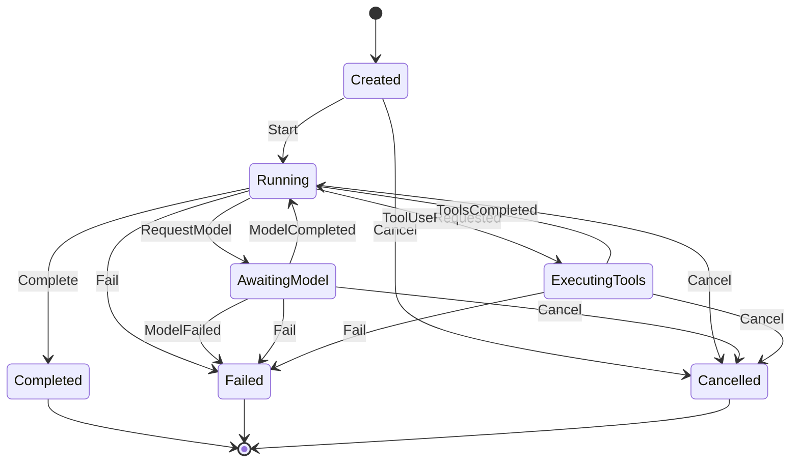

# 运行生命周期（Run Lifecycle）

> 状态：状态机已实现并全路径测试（`mycelium_core::run`）；事件顺序与流装配等运行时契约标记为 Planned。

## 1. 形式化定义（五元组）

```
M = (S, E, δ, s0, F)

S  = { Created, Running, AwaitingModel, ExecutingTools, Completed, Failed, Cancelled }
E  = { Start, RequestModel, ModelCompleted, ModelFailed,
       ToolUseRequested, ToolsCompleted, Complete, Fail, Cancel }
s0 = Created
F  = { Completed, Failed, Cancelled }            （终止状态）
δ  = 见 §3 转移表；δ 未定义处必须返回 InvalidRunTransition { from, event }
```

实现：`mycelium_core::run::RunState::transition`（纯函数，无副作用；v0.1 已实现）。
v0.2 起由 `mycelium-runtime` 的执行循环驱动，并在循环边界强制预算、取消与超时。

- 合法转移返回目标状态；
- 非法转移**必须显式拒绝**（`InvalidRunTransition`），禁止静默忽略或原地停留；
- 终止状态（`F`）吸收一切事件，不存在出边。

## 2. 状态图



## 3. 合法转移表（14 条边）

| # | from | event | to | 语义 |
| :--- | :--- | :--- | :--- | :--- |
| 1 | `Created` | `Start` | `Running` | 运行启动 |
| 2 | `Created` | `Cancel` | `Cancelled` | 启动前取消 |
| 3 | `Running` | `RequestModel` | `AwaitingModel` | 发出模型请求 |
| 4 | `Running` | `ToolUseRequested` | `ExecutingTools` | 模型要求调用工具 |
| 5 | `Running` | `Complete` | `Completed` | 本次运行正常完成 |
| 6 | `Running` | `Fail` | `Failed` | 运行级失败 |
| 7 | `Running` | `Cancel` | `Cancelled` | 运行中被取消 |
| 8 | `AwaitingModel` | `ModelCompleted` | `Running` | 模型响应就绪 |
| 9 | `AwaitingModel` | `ModelFailed` | `Failed` | 模型层错误（不可恢复时） |
| 10 | `AwaitingModel` | `Fail` | `Failed` | 运行级失败 |
| 11 | `AwaitingModel` | `Cancel` | `Cancelled` | 等待模型时取消 |
| 12 | `ExecutingTools` | `ToolsCompleted` | `Running` | 工具执行完毕，进入下一轮 |
| 13 | `ExecutingTools` | `Fail` | `Failed` | 运行级失败 |
| 14 | `ExecutingTools` | `Cancel` | `Cancelled` | 工具执行中取消 |

> 测试 `transition_table_is_exhaustive` 以本表为期望矩阵，对 `S × E`（7 × 9 = 63）全组合逐一比对。

## 4. 非法转移拦截（负向路径）

| 场景 | 输入 | 期望行为 |
| :--- | :--- | :--- |
| 未启动即请求模型 | `Created` + `RequestModel` | `Err(InvalidRunTransition)` |
| 终止后继续操作 | `Completed`/`Failed`/`Cancelled` + 任意事件 | `Err(InvalidRunTransition)` |
| 跳过模型直接完成工具 | `ExecutingTools` + `Complete` | `Err(InvalidRunTransition)` |
| 无序完成 | `AwaitingModel` + `Complete` | `Err(InvalidRunTransition)` |
| 重复启动 | `Running` + `Start` | `Err(InvalidRunTransition)` |

全部非法组合由 `run::tests::terminal_states_absorb_all_events` 与
`run::tests::transition_table_is_exhaustive` 覆盖；错误必须携带 `from` 与 `event` 上下文。

## 5. 事件顺序不变量（v0.2 已实现，测试映射见 FC-INV-020 ~ FC-INV-022）

由 v0.2 执行循环实现并测试：

1. 单个 Run 内 `AgentEvent::seq` 从 0 开始连续单调递增，`run_id` 恒等于所属 Run；
2. `RunStarted` 为首条事件；终态事件（`RunCompleted` / `RunFailed` / `RunCancelled`）恰好一条且为最后一条；
3. `ToolCallStarted` 与 `ToolCallFinished` 以 `call_id` 一一配对（运行在工具阶段被取消时同样补齐 `Finished`，`is_error = true`）；
4. `StepStarted { step }` 从 1 开始连续递增。

事件由 `mycelium-runtime` 的引擎统一发射；事件是可选观测面（`run_events` 或 `RunHooks`），不影响运行结果。

## 6. 模型流装配契约（v0.2 已实现）

实现：`mycelium-model::assembler::DeltaAssembler`。`ModelProvider` 返回的 `ModelStream` 必须满足
（违反者归约为 `ModelError::InvalidResponse`，测试映射见 FC-ERR-010 ~ FC-ERR-015）：

1. 成功流最后一项必须是 `ModelDelta::Finished`，且恰好一条；
2. `Finished` 之后不得再产出任何项；
3. `Usage` 至多一条，且位于 `Finished` 之前；
4. `ToolCallDelta.index` 从 0 开始连续；同一 `index` 的首个增量必带 `id` 与 `name`，
   其后仅携带 `arguments_json_delta`；
5. 中途失败以 `Err(ModelError)` 结束，其后不得再产出项。

装配结果（`ModelResponse`）：文本增量拼接为单个 `Text` 块（无文本且有工具调用时不产生文本块），
工具调用按 `index` 升序转为 `ToolUse` 块，参数为空串时视为 `{}`；思考（推理）增量拼接为单个
`Thinking` 块并位于 `Text` 块之前（v0.3，见 FC-Matrix §2.20）。

## 7. 工具执行契约（v0.2 已实现 1 / 2 / 4 / 5；条目 3 见 roadmap v0.3）

1. 执行前按 `input_schema` 校验入参（JSON Schema 子集，见 FC-Matrix §2.13），失败以错误结果回灌；
2. 工具必须响应 `ToolContext::cancel`，返回 `ToolError::Cancelled` 时归约为 Run 级 `Cancelled`；
3. 工具超时由运行时策略层统一施加（v0.3），超限归约为 `ToolError::Timeout`；
4. 工具执行失败不终止 Run：错误以 `ToolOutput::error` 形式回灌给模型，由模型决定后续动作
   （工具未注册 / 入参非法 / 执行失败均适用）；
5. v0.2 为顺序执行，结果顺序与调用顺序一致；v0.3 并发执行时通过 `call_id` 关联、按调用顺序回灌。
