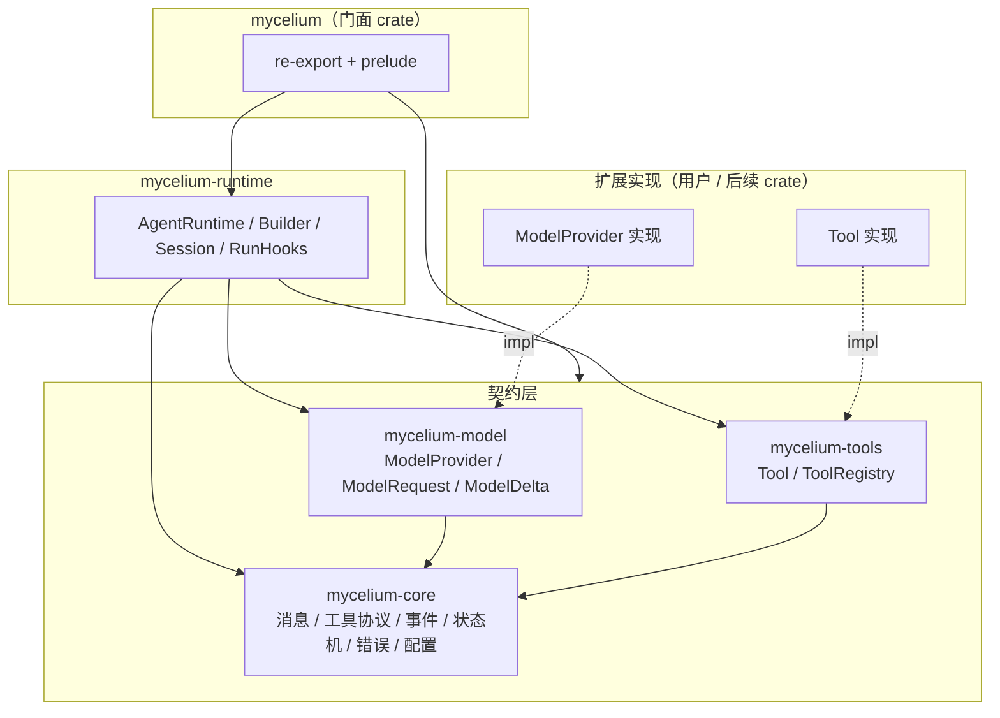

# mycelium 架构总览

> 状态：v0.1 架构骨架（2026-10-14）。执行循环与具体 Provider 尚未实现，见 §11 与 `roadmap.md`。

## 1. 定位

mycelium 是面向 Rust 的 agent SDK，采用**分层通用核心**策略：内核不假设上层产品形态，
因此同一套内核可以支撑两种演进方向：

1. **可嵌入框架**：应用把运行时嵌入自己的进程（对话式 Agent、工作流节点、代码助手）；
2. **本地 Agent 运行时**：以会话管理、工具沙箱、权限审批与 hooks 为核心的服务形态。

## 2. 设计原则

| 原则 | 落地方式 |
| :--- | :--- |
| 契约优先 | 公共行为先进入 `docs/spec/core.md`（FC-Matrix），再写测试，最后写实现 |
| 类型即约束 | newtype + 枚举表达不变量，构造即校验（非法状态不可表示） |
| 显式失败 | 不存在静默降级；未实现的功能返回 `AgentError::Unimplemented` |
| 单一运行时 | tokio；取消统一使用 `CancellationToken` |
| 单向分层 | 依赖只能指向 `mycelium-core`，禁止反向依赖与循环依赖 |
| 插件化扩展 | 三个 SPI：`ModelProvider` / `Tool` / `RunHooks` |
| 可观测 | 事件（`AgentEvent`）即观测面；tracing 埋点在 v0.2 引入 |

## 3. 分层与依赖方向

依赖方向规则（由 CI 的 `cargo` 构建与代码评审共同保证）：

1. 只允许 `门面 → runtime → (model | tools) → core` 方向；
2. `model` 与 `tools` 互不依赖（两者都仅依赖 `core`）；
3. `core` 不依赖任何 IO 与异步运行时（仅 serde / uuid / tokio-util 取消原语）。

## 4. crate 职责

| crate | 职责 | 关键类型 | v0.1 状态 |
| :--- | :--- | :--- | :--- |
| `mycelium-core` | 领域内核：标识、消息、工具协议、事件、状态机、错误、配置 | `Message`、`ToolSpec`、`AgentEvent`、`RunState`、`AgentError`、`AgentConfig` | 类型与纯逻辑完成 |
| `mycelium-model` | 模型提供方抽象（SPI） | `ModelProvider`、`ModelRequest`、`ModelDelta`、`ModelStream` | trait 契约完成，无实现 |
| `mycelium-tools` | 工具抽象（SPI）与注册表 | `Tool`、`ToolRegistry`、`ToolContext`、`ToolOutput` | trait + 注册表完成 |
| `mycelium-runtime` | 执行引擎：装配、循环（v0.2）、会话、钩子 | `AgentRuntime`、`AgentRuntimeBuilder`、`Session`、`RunHooks` | 装配完成，循环未实现 |
| `mycelium` | 门面：re-export、prelude、端到端示例 | `prelude` | 完成 |

> 发布名（v1.0 起）：上表 crate 的 crates.io 包名为 `mycelium-agent-*`；Rust 导入名保持 `mycelium_*`
> 不变（`[lib] name` 固定），映射与依赖写法见 [`migration-v0-to-v1.md`](migration-v0-to-v1.md) §1。

## 5. 核心概念

| 概念 | 说明 |
| :--- | :--- |
| **Session** | 跨多轮对话的消息累积容器（当前为进程内存储，持久化在 v0.4） |
| **Run** | 一次完整的「输入 → 模型 → 工具 → …→ 终态」执行；生命周期见 `lifecycle.md` |
| **Step** | Run 内的一轮：一次模型请求 + 其触发的工具执行 |
| **Message / ContentBlock** | 统一消息模型；内容块支持文本、思考、工具调用、工具结果 |
| **Thinking** | 模型思考（推理）内容：只读观测，装配为 `Thinking` 块且不回传提供方 |
| **Tool** | 模型可调用的能力单元；由 `ToolSpec`（名称 / 描述 / JSON Schema）描述 |
| **ToolCall / ToolOutput** | 调用请求与执行结果；结果错误通过 `is_error` 回灌给模型继续推理 |
| **ModelDelta** | 模型流式增量；装配规则见 FC-Matrix §4（Planned） |
| **AgentEvent** | 运行过程事件（观测与传输的统一格式） |
| **RunHooks** | 同步观察者扩展点（运行 / 步 / 工具粒度） |

## 6. 运行模型（v0.2 已实现主体；并发与工具超时为 v0.3）

- 单次 Run 执行在独立 tokio 任务中，`run_id` 贯穿所有事件与日志；
- 主循环：请求模型（流式装配）→ 顺序执行工具 → 结果回灌 → 直至无工具调用或到达预算上限；
- 工具执行 v0.2 为顺序执行（结果顺序与调用顺序一致），v0.3 引入可配置并发；
- 取消：`RunInput.cancel` 触发后传播到在途模型流、工具执行与重试退避，Run 进入 `Cancelled`；
- 超时：模型请求超时由 `AgentConfig::request_timeout` 控制；工具超时由 `AgentConfig::tool_timeout` 控制；
- 重试：可重试模型错误按 `AgentConfig::retry`（`RetryPolicy`）指数退避自动重试，
  发射 `ModelRetry` 事件；退避等待可被取消打断；多 Provider 场景可用
  `FallbackProvider` 按序降级；
- 预算：步数 / 输出 Token / 时长（`max_duration`）三类预算，超限停止发起新请求；
- 事件：Run 内 `seq` 从 0 连续递增；终态事件唯一（见 `lifecycle.md` §5，已测试）；
- 事件为可选观测面：`run_events` 返回流式事件；`RunHooks` 提供异步回调（RFC-0001）。

## 7. 扩展点（SPI）

| 扩展点 | 位置 | 用途 | 后续演进 |
| :--- | :--- | :--- | :--- |
| `ModelProvider` | `mycelium-model` | 接入任意模型服务（HTTP / 本地推理） | v0.2 已提供 `mycelium-provider-openai`；v0.4 多 Provider 路由 |
| `Tool` | `mycelium-tools` | 接入任意工具（函数、HTTP、MCP） | v0.3 提供 derive 宏与 MCP 适配 |
| `RunHooks` | `mycelium-runtime` | 观测与拦截（异步审计 / 指标） | v0.5 已异步化（RFC-0001）；改写能力见后续 RFC |
| `SessionStore` | `mycelium-runtime` | 会话持久化（可插拔存储后端） | v0.5 已提供内存 / 文件实现；数据库 / 云存储在生态侧 |
| `Memory` | `mycelium-runtime` | 跨会话长期记忆（写入 / 召回 / 遗忘） | v0.6 已提供 SPI 与朴素内存实现；向量检索在生态侧 |
| MCP 服务 | `mycelium-mcp` | 以 stdio / streamable HTTP 接入 MCP 生态（工具 / 资源 / 提示模板） | v0.3 工具；v0.7 资源 / 提示 / HTTP |

## 8. 错误模型

错误分类矩阵在 `mycelium-core::error` 集中定义（单一真实来源），逐层 re-export：

| 错误 | 语义 | 可重试 | 关键上下文 |
| :--- | :--- | :--- | :--- |
| `ConfigError` | 配置非法 | 否（修正配置） | 字段名与非法值 |
| `ModelError::Transport` | 网络 / IO 失败 | 是 | 描述信息 |
| `ModelError::Api` | 提供方错误响应 | 408 / 429 / 5xx 可重试 | HTTP 状态、错误码 |
| `ModelError::RateLimited` | 限流 | 是 | 建议重试间隔 |
| `ModelError::Timeout` | 请求超时 | 是 | 超时毫秒数 |
| `ModelError::ContextLengthExceeded` | 上下文超限 | 否 | requested / limit |
| `ModelError::InvalidResponse` | 提供方违反流协议 | 否 | 违约细节 |
| `ToolError::*` | 工具层错误（未注册 / 入参 / 拒绝 / 执行 / 超时 / 取消） | 否（回灌模型） | 工具名与原因 |
| `AgentError::BudgetExceeded` | 预算超限 | 否 | 类别 / 上限 / 实测 |
| `AgentError::Unimplemented` | 功能未实现（显式失败，绝不静默成功） | 否 | 功能名 |

## 9. 依赖清单与理由

| 依赖 | 使用范围 | 理由 |
| :--- | :--- | :--- |
| `serde` / `serde_json` | core / model / tools / provider | wire 格式与 JSON Schema 的生态标准，无可行替代 |
| `thiserror` | core / model / tools / mcp / runtime / provider | 错误枚举样板，编译期展开、零运行时开销 |
| `async-trait` | model / tools | stable 上对象安全异步 trait 的标准做法（`Arc<dyn Tool>` 要求 dyn 兼容） |
| `uuid`（v7） | core / runtime | 时间有序 ID（会话 / 运行 / 记忆），便于持久化与排序 |
| `tokio` / `tokio-util` | runtime / provider（及测试） | 栈基线决策；`CancellationToken` 作为统一取消原语 |
| `futures-core` / `futures-util` | model / runtime | `Stream` 抽象与流构造工具 |
| `reqwest`（rustls-no-provider） | provider-openai / mcp | HTTP 客户端（模型调用与 MCP streamable HTTP）；不启用默认 TLS 后端，改用 ring（见下行） |
| `rustls`（ring 后端） | provider-openai / mcp | TLS 实现；ring 后端仅需 C 编译器、无需 cmake（aws-lc-rs 需要 cmake，刻意规避） |
| `tracing` | runtime / provider / mcp | 结构化日志；联调原始交互（HTTP 请求体 / SSE 行 / JSON-RPC 原文）经 subscriber 落盘（见 `docs/integration/`） |
| `tracing-subscriber`（dev） | 门面示例 | 联调日志落盘订阅器（TRACE 全量，无 ANSI） |
| `proptest`（dev） | core、model | FSVDD 强制要求的基于属性测试 |

依赖纪律：禁止 `*` 版本范围；新增依赖必须在本表登记理由并说明是否可零依赖实现。

## 10. 安全考量

- 工具入参：schema 校验在 v0.2 引入（`ToolError::InvalidArguments` 语义已定义）；
- 权限：v0.3 引入策略层（`ToolError::Denied`）；内核不做隐式默认放行；
- `unsafe`：workspace 级 `forbid`，当前代码库零 `unsafe`；
- 密钥：绝不进入配置结构；由 Provider 实现自行从环境读取（约定：`MYCELIUM_*` 前缀，具体见各实现文档）；
- 边界输入：所有来自模型 / 用户的字符串在构造点完成校验（`ToolName` / `ToolCallId` / `ModelId`）。

## 11. 现状与路线

v0.1 已完成：分层结构、领域类型、三个 SPI 契约、错误分类矩阵、状态机（全路径测试）、
FC-Matrix 与测试一一对应、CI 基线。

v0.2 已完成：执行循环（顺序工具、预算、取消、超时）、流式增量装配器、工具入参 JSON Schema
子集校验、事件发射与 `run_events` 流式 API、OpenAI 兼容 Provider（含本地 stub server 端到端测试）。

v0.3 已完成：工具并发执行与保序回灌、工具超时、权限策略层（`ToolPolicy`）、
`#[tool]` 派生宏、MCP 客户端适配（stdio / tools）、模型思考过程支持（DeepSeek `reasoning_content`
→ `Thinking` 块 / 事件 / `reasoning_tokens`），并通过 DeepSeek V4.1-Flash 真实联调验证。

v0.4 已完成第一批：结构化工具结果（图文多内容块，RFC-0002）、异步钩子（RFC-0001）、
重试策略与 `ModelRetry` 事件、多 Provider 降级（`FallbackProvider`）、时长预算、MSRV CI。

v0.5 已完成：多轮会话（`SessionStore` SPI + 内存/文件实现 + `run_session`）与
子 Agent 编排（`AgentTool`：agent-as-tool），并经 DeepSeek 五场景真实联调验证。

v0.6 已完成：长期记忆 SPI（`Memory` + `InMemoryMemory`）、JSON Schema 子集扩充
（组合/边界/长度/数组约束）、tracing 结构化 span（`mycelium.run` / `step` / `tool`）。

v0.7 已完成：MCP 完整化 —— 资源（`resources/list` / `read`）、提示模板（`prompts/list` / `get`）、
streamable HTTP 传输（会话头 / JSON 与 SSE / 通知 202）与 `Transport` 抽象重构。

尚未实现（见 roadmap）：MCP 采样回调与通知订阅、剩余 JSON Schema 关键字、外部记忆后端、
cargo-mutants / cargo-deny。

- 生命周期与状态机：`docs/architecture/lifecycle.md`
- 形式化约束矩阵：`docs/spec/core.md`
- 里程碑：`docs/architecture/roadmap.md`
